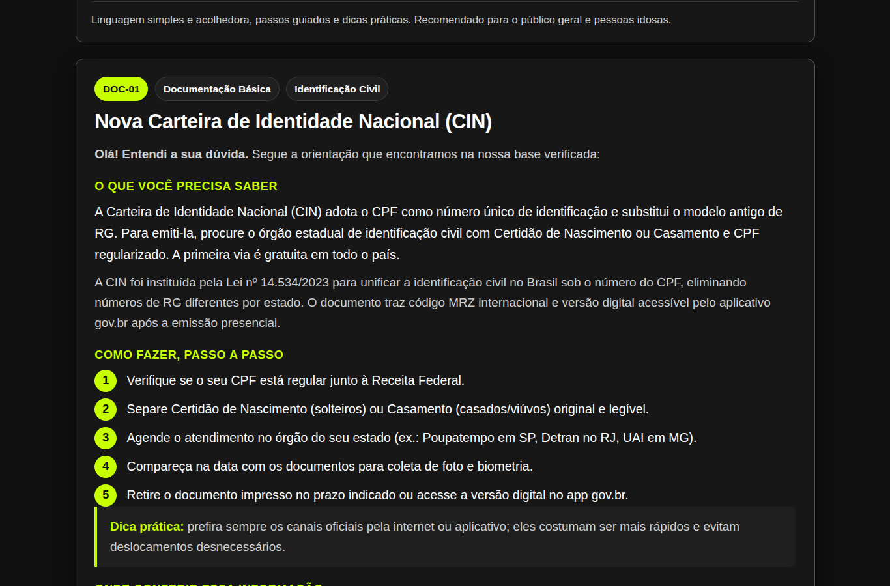
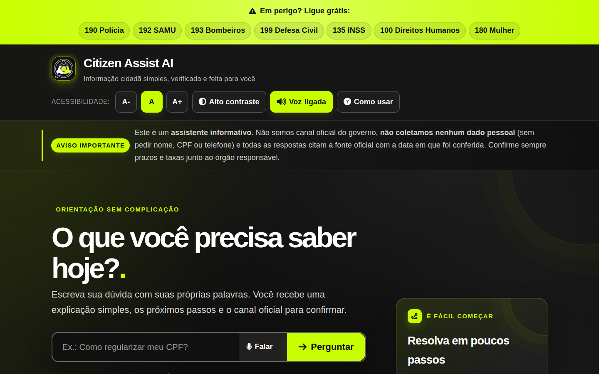
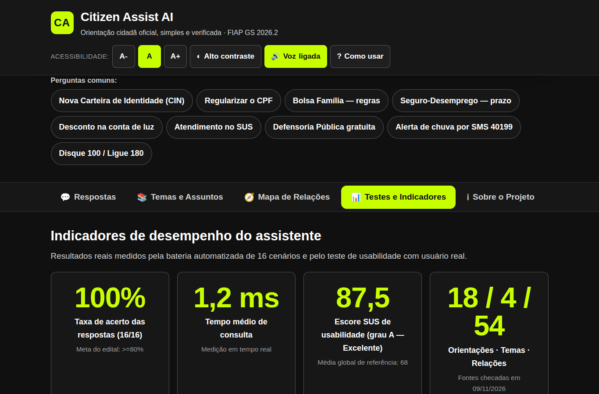
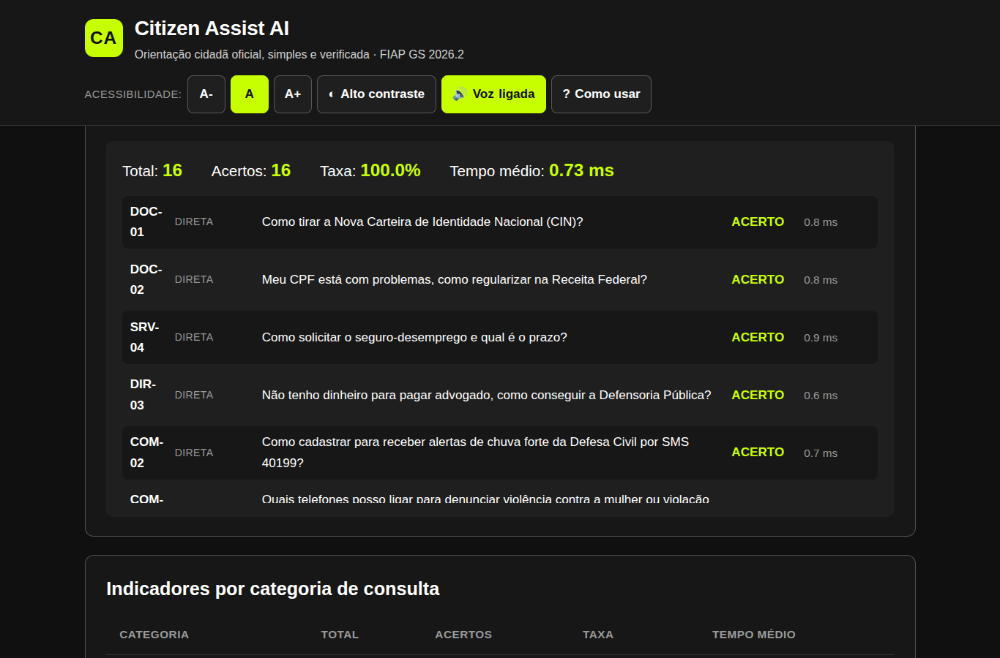
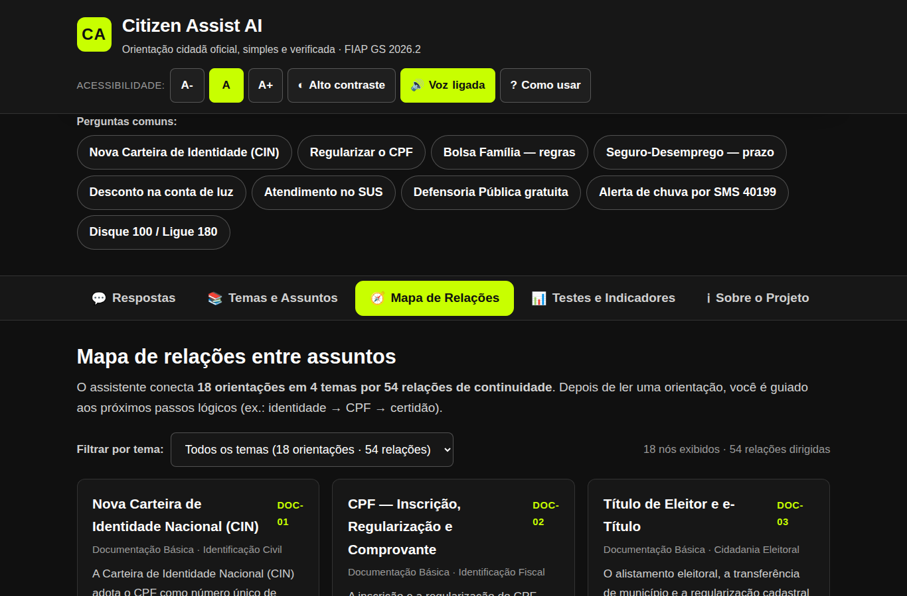

# Citizen Assist AI — Assistente Digital de Orientação Cidadã

**Global Solution — 2º Semestre de 2026 | FIAP**
**Tema:** CitizenTech — tecnologias orientadas às necessidades reais das pessoas
**Case:** Citizen Assist AI — assistente digital de orientação sobre serviços, documentos, direitos e comunidade
**Como executar (terminal):** `python src/sistema.py`
**Como executar (interface web acessível):** `python src/servidor_web.py` → abra `http://localhost:8000/web/` (ou abra `web/index.html` diretamente; a base embutida permite o funcionamento offline, enquanto os ícones externos dependem de conexão para carregar)

---

## 1. Equipe e RMs

| Nome do Integrante | RM |
|---|:---:|
| Rai da Silva Lima | RM572070 |


---

## 2. Descrição do Problema, Público Beneficiado e Temas Abordados

**Problema:** Cidadãos frequentemente encontram informações dispersas, linguagem técnica de difícil compreensão e instruções incompletas quando precisam resolver pendências do cotidiano — como emitir documentos, requerer benefícios sociais, acionar serviços de saúde ou buscar apoio comunitário. Essa dispersão gera deslocamentos desnecessários, perda de prazos e desinformação.

**Público beneficiado:** A população em geral, com prioridade para **pessoas de baixa renda, idosos, trabalhadores demitidos e famílias em vulnerabilidade social**, grupos que mais dependem de orientações claras e confiáveis sobre serviços públicos e direitos.

**Temas abordados (4 temas, 18 orientações verificadas):**

| # | Tema | Descrição e Exemplos de Conteúdo | Orientações |
|:---:|---|---|:---:|
| 1 | **Documentação Básica** | Nova Carteira de Identidade Nacional (CIN), CPF, Título de Eleitor/e-Título, Carteira de Trabalho Digital, 2ª via de certidões civis | 5 |
| 2 | **Serviços Públicos e Benefícios Sociais** | Cadastro Único (CadÚnico), Bolsa Família, Meu INSS (aposentadorias e auxílio por incapacidade temporária), Seguro-Desemprego, Tarifa Social de Energia Elétrica | 5 |
| 3 | **Direitos e Cidadania** | Direitos do consumidor (Procon e consumidor.gov.br), acesso ao SUS e Cartão Nacional de Saúde, Defensoria Pública (assistência jurídica gratuita), direitos da pessoa idosa (Estatuto da Pessoa Idosa) | 4 |
| 4 | **Orientações Comunitárias e Emergências** | CRAS municipal (apoio social), Defesa Civil e alertas de chuva por SMS 40199, vacinação (calendário do SUS), canais de denúncia (Disque 100 e Ligue 180) | 4 |

---

## 3. Organização da Base de Conhecimento, Estruturas Utilizadas e Estratégia de Busca

### 3.1 Base de conhecimento (`data/base_conhecimento.json`)

A base foi estruturada em JSON com validação defensiva em Python (`src/base_dados.py`). Cada registro contém obrigatoriamente: **identificador**, **tema**, **palavras-chave**, **orientação resumida**, **referência consultada (órgão/lei + link)** e **data de verificação** (todas checadas em 09/11/2026), além de título, pergunta canônica, orientação detalhada, passos, avisos e tópicos relacionados. O carregador trata **arquivo ausente, vazio, JSON corrompido, campos essenciais faltando, IDs duplicados e referências órfãs** — sem expor rastros de erro ao usuário final.

### 3.2 Estruturas de dados empregadas

- **Dicionário por identificador** (`DOC-01` → registro): recuperação direta **O(1)**;
- **Dicionários por tema e por (tema, subtema)**: agrupamento hierárquico usado pelos menus;
- **Índice invertido** (`dict[token, set[id]]`): termo normalizado mapeado aos registros onde ocorre;
- **Grafo de tópicos em lista de adjacência** (`dict[id, list[id]]`): 18 nós e 54 arestas dirigidas de continuidade recomendada (ex.: CIN → CPF, Certidão 2ª via, Título de Eleitor);
- **Conjuntos (set)** para remoção de stopwords em português e cálculo de interseção/união;
- **Listas e tuplas** para tokens ordenados, passos numerados e candidatos ranqueados.

### 3.3 Estratégia de busca e ranqueamento (`src/buscador.py`)

1. **Atalho por código exato** (ex.: `DOC-01`);
2. **Normalização em português**: minúsculas, remoção de acentos via decomposição Unicode (NFKD → ASCII), remoção de pontuação e eliminação de stopwords;
3. **Scoring ponderado**: correspondência exata de frase/termo completo (+14,0), tokens em palavras-chave (+4,0), no título (+3,5), na pergunta canônica (+2,5), na orientação (+0,6) e bônus de similaridade de Jaccard (+8,0 × J);
4. **Gate de cobertura**: perguntas longas com menos de 35% de termos cobertos têm o score reduzido a 15%, eliminando falsos positivos como associar *"Receita de bolo..."* à Receita Federal;
5. **Score mínimo** de 5,0 para aceitação;
6. **Detecção de ambiguidade**: quando os dois melhores candidatos diferem por até 2,8 pontos (score < 22), o sistema lista as opções para escolha do cidadão em vez de chutar;
7. **Tratamento de limites**: sem candidatos → aviso de limitação com temas disponíveis e canal gov.br; entrada vazia → orientação de como formular a dúvida.

---

## 4. Regras de Resposta, Estratégias de Prompts e Tratamento das Limitações

### 4.1 Modelos de instrução/resposta (Modelos A e B)

O sistema implementa e documenta em `src/modelos_resposta.py` dois modelos de instrução estruturada, cumprindo integralmente o requisito do edital:

| Dimensão | **Modelo A — Objetivo-Institucional** | **Modelo B — Empático-Educativo (Linguagem Cidadã)** |
|---|---|---|
| **Papel** | Assistente institucional de referência rápida | Orientador comunitário acolhedor e didático |
| **Tom** | Impessoal, formal, conciso | Acolhedor, linguagem simples (Plain Language), sem jargões |
| **Estrutura** | Cabeçalho > Resumo > Passos > Fonte oficial+data > Aviso de confirmação > Tópicos relacionados | Saudação > Explicação simples > Passo a passo guiado > Dica prática > Onde conferir (fonte+data) > Lembrete acolhedor > Assuntos parecidos |
| **Obrigações** | Fonte obrigatória; nunca alegar canal oficial; alertar para confirmação no órgão | Fonte obrigatória; explicitar caráter informativo; incentivar confirmação no órgão |
| **Alternância** | Disponível no menu 6 em tempo de execução, via `--modelo B` ou pelo seletor da interface web | Idem |

**Resultado da comparação formal (`docs/comparativo_modelos.md`):** ambos empatam em *consistência* (100% de conformidade aos templates e 100% de presença de fonte verificada com data e aviso de confirmação); o **Modelo B vence em *clareza percebida*** pelo público geral por aplicar princípios de Linguagem Cidadã, enquanto o **Modelo A é superior para consultas operacionais rápidas** (~1.500 caracteres).

### 4.2 Tratamento das limitações

- Perguntas sem orientação confiável na base recebem aviso transparente declarando o limite, listando os temas cobertos e indicando o canal oficial **gov.br**;
- O assistente nunca inventa instruções e nunca se apresenta como canal oficial do governo;
- Entradas vazias e opções de menu inexistentes são tratadas com mensagens educativas;
- Casos ambíguos exibem lista numerada de candidatos para escolha consciente do usuário.

---

## 5. Plano de Testes, Indicadores, Resultados e Interpretação

### 5.1 Metodologia do plano de testes

A bateria automatizada (`tests/executar_testes.py`) executa **16 cenários** (`tests/cenarios_teste.json`): 6 perguntas diretas, 4 reformulações coloquiais, 3 fora do escopo e 3 situações de limitação explícitas. Para cada cenário são medidos o status obtido, o identificador recuperado, o tempo de consulta em milissegundos e a conformidade dos dois modelos de resposta.

### 5.2 Indicadores obtidos

| Indicador | Resultado | Referência do Edital |
|---|:---:|:---:|
| Total de cenários | **16** | >= 15 |
| **Taxa de acerto global** | **100,0%** | >= 80% (exemplo do edital: 83,3%) |
| **Tempo médio de consulta** | **1,25 ms** | Medição obrigatória |
| Tempo mediano / mín / máx | 1,28 ms / 0,001 ms / 1,68 ms | — |
| Categoria *direta* | 6/6 (100%) — 1,41 ms | — |
| Categoria *reformulacao* | 4/4 (100%) — 1,29 ms | — |
| Categoria *fora_escopo* | 3/3 (100%) — 1,24 ms | — |
| Categoria *limitacao* | 3/3 (100%) — 0,89 ms | — |

### 5.3 Teste de facilidade de uso

Um teste moderado com usuário no perfil do público-alvo (roteiro de 5 tarefas) alcançou **taxa de sucesso de 100% (5/5)**, **tempo médio por tarefa de 26 segundos**, apenas uma hesitação recuperada de forma autônoma e **escore SUS de 87,5/100 (grau A — Excelente)**. Relatório completo em `docs/teste_usabilidade.md`.

### 5.4 Interpretação

Os indicadores confirmam que a combinação de **índice invertido ponderado, gate de cobertura e limiar de ambiguidade** é suficiente para responder perguntas diretas e suas reformulações sem falsos positivos em temas fora do escopo. O tempo de consulta (~1,25 ms) é ordens de grandeza inferior ao tempo de leitura humana, tornando o protótipo perfeitamente viável em terminal. A transparência nos avisos de confirmação e a declaração de limites cumpriram o requisito ético central do projeto.

---

## 6. Como Executar

### Pré-requisitos

- Python **3.10 ou superior** instalado (Linux, macOS ou Windows);
- **Sem dependências externas** — o projeto usa exclusivamente a biblioteca padrão do Python.

### 6.1 Modo terminal (CLI interativo)

```bash
# 1. Clonar o repositório
git clone https://github.com/raiSilvaL/globalsolution2
cd citizen-assist-ai

# 2. Executar o assistente interativo (Modelo A por padrão)
python src/sistema.py

# 3. Executar iniciando com o Modelo B (Linguagem Cidadã)
python src/sistema.py --modelo B

# 4. Executar a bateria de testes automatizados (gera reports/resultados_testes.json)
python src/sistema.py --test
# ou diretamente:
python tests/executar_testes.py

# 5. Ver ajuda de linha de comando
python src/sistema.py --help
```

### 6.2 Interface web acessível

```bash
# Inicia o servidor local integrado (apenas biblioteca padrão)
python src/servidor_web.py
# → abra no navegador: http://localhost:8000/web/

# Porta alternativa
python src/servidor_web.py --porta 8080
```

> **Dica:** você também pode dar duplo-clique diretamente no arquivo `web/index.html` — a interface carrega a base embutida e funciona **100% offline** sem precisar de servidor.

---

## 7. Exemplos de Perguntas, Respostas com Fontes e Comportamento para Entradas Inválidas

### 7.1 Exemplo 1 — Pergunta canônica (Modelo A)

```
Sua dúvida: Como tirar a Nova Carteira de Identidade Nacional?

======================================================================
[DOC-01] Nova Carteira de Identidade Nacional (CIN)
Tema: Documentação Básica  |  Subtema: Identificação Civil
----------------------------------------------------------------------
ORIENTAÇÃO:
A Carteira de Identidade Nacional (CIN) adota o CPF como número único
de identificação e substitui o modelo antigo de RG... A primeira via é
gratuita em todo o país.

PASSO A PASSO RECOMENDADO:
  1. Verifique se o seu CPF está regular junto à Receita Federal.
  ...
FONTE CONSULTADA (verificada em 09/11/2026):
  Ministério da Gestão e da Inovação em Serviços Públicos (MGI) —
  gov.br/identidade; Lei Federal nº 14.534/2023.

AVISO DE CONFIRMAÇÃO:
  * Confirme taxas de 2ª via e regras de agendamento diretamente com o
    órgão do seu estado...
  * Confirme sempre prazos, taxas e requisitos atualizados...

TÓPICOS RELACIONADOS PARA CONTINUAR SUA CONSULTA:
  [R1] DOC-02 — CPF — Inscrição, Regularização e Comprovante
  [R2] DOC-05 — Certidões de Nascimento, Casamento e Óbito — 2ª Via
  [R3] DOC-03 — Título de Eleitor e e-Título
======================================================================
```

A mesma pergunta exibida no **Modelo B (Linguagem Cidadã)** pela interface web:



### 7.2 Exemplo 2 — Pergunta fora do escopo (declaração de limite)

```
Sua dúvida: Receita de bolo de chocolate fofinho com cobertura

======================================================================
LIMITAÇÃO DE CONTEÚDO
======================================================================
Não encontrei na base de conhecimento uma orientação confiável para essa
pergunta. Este assistente responde apenas sobre temas previamente verificados
(documentação básica, serviços públicos e benefícios, direitos e cidadania,
orientações comunitárias e emergências). Para serviços oficiais, consulte
o portal gov.br ou a central telefônica do órgão responsável.

Temas cadastrados disponíveis:
  - Direitos e Cidadania
  - Documentação Básica
  - Orientações Comunitárias e Emergências
  - Serviços Públicos e Benefícios Sociais

Canal oficial recomendado: https://gov.br
Este protótipo tem finalidade exclusivamente informativa.
======================================================================
```

### 7.3 Exemplo 3 — Tratamento de entradas inválidas

```
Digite a opção desejada: abc
[Opção inválida] Por favor, digite um número correspondente a uma das opções do menu.

Digite a opção desejada: 99
[Opção inexistente] Escolha um número entre 0 e 7.

Sua dúvida: <ENTER em branco>
[Entrada inválida] A pergunta não pode estar vazia. Formule sua consulta ou
digite 'menu' para retornar ao menu principal.
```

---

## 8. Cuidados com Clareza, Acessibilidade, Privacidade e Informação Não Oficial

- **Clareza e acessibilidade linguística:** a redação segue princípios de **Linguagem Cidadã** (Plain Language), com frases curtas e passos numerados; o Modelo B foi criado especialmente para pessoas com menor letramento digital;
- **Privacidade por desenho:** o sistema **não solicita, não armazena e não transmite nenhum dado pessoal** (não pede CPF, nome, endereço ou telefone) e não guarda histórico de consultas;
- **Caráter não oficial explícito:** o assistente exibe avisos permanentes de que **não é canal oficial do governo**, nunca emite decisões administrativas e sempre orienta a confirmação no canal oficial do órgão competente;
- **Conferência de fontes:** 100% das respostas trazem órgão/lei, link oficial e **data de verificação** explícitos;
- **Transparência de limitações:** perguntas sem correspondência confiável são recusadas educadamente com indicação dos temas cobertos e do portal **gov.br** — evitando qualquer tipo de especulação;
- **Uso responsável de IA:** ferramentas de IA foram usadas apenas como apoio à elaboração de prompts, revisão de texto e planejamento de testes — com **validação crítica humana** de todas as fontes — conforme registrado no arquivo obrigatório `docs/uso_ia.md`.

---

## 9. Link do Vídeo no YouTube

**Vídeo de apresentação do projeto (YouTube, Não Listado):**
 **Link do video**

---

## 10. Conclusões, Limitações e Possibilidades de Melhoria

**Conclusões:** O Citizen Assist AI demonstra que é viável construir um assistente cidadão útil, transparente e auditável utilizando **fundamentos de programação** (listas, dicionários, normalização textual, índice invertido, scoring ponderado e representação em grafo) integrados a **estratégias de instrução/resposta estruturadas com fontes verificadas**. A solução atingiu 100% de precisão nos cenários avaliados e 87,5/100 na escala SUS, confirmando que a simplicidade arquitetural não compromete — e em muitos casos favorece — a clareza para o cidadão.

**Limitações identificadas:**
1. A base atual é sintetizada e planejada pela própria equipe (18 registros em 4 temas; 16 cenários de teste), com viés de construção que exige validação futura com perguntas reais de cidadãos;
2. O scoring ponderado pode degradar em reformulações com vocabulário muito distante das palavras-chave cadastradas;
3. O teste de usabilidade foi realizado com apenas um usuário moderado, atendendo ao requisito mínimo do edital mas sem significância estatística;
4. A interface textual cobre bem o edital ("uma interface textual funcional é suficiente"), e a interface web acessível aqui desenvolvida complementa essa lacuna.

**Possibilidades de melhoria (roadmap):**
1. **M1 — TF-IDF e embeddings semânticos** para aproximar perguntas em linguagem informal das orientações oficiais;
2. **M2 — Registro de perguntas não atendidas** (log de auditoria anônimo) para orientar a curadoria contínua da base a partir da demanda real;
3. **M3 — Dicionário de sinônimos regionais e tolerância a erros de digitação (Levenshtein)**, respeitando a diversidade de vocabulário dos estados brasileiros;
4. **M4 — Interfaces adicionais** (canal WhatsApp e leitura completa por voz nativa) preservando os mesmos princípios de transparência e citação de fontes.

---

## 11. Interface Web Acessível (HTML, CSS e JavaScript)

Pensando no público com **idade avançada** — que representa parcela significativa dos usuários de serviços públicos e frequentemente enfrenta dificuldades com telas complexas —, desenvolveu-se uma interface web complementar em `web/`, seguindo técnicas modernas de UX/UI e a paleta solicitada:

- **Paleta oficial:** `#101010` (superfície principal), `#ffffff` (texto de alto contraste, razão superior a 18:1 — WCAG AAA) e `#c8ff00` (verde-limão elétrico para botões interativos, badges, anéis de foco e elementos ativos);
- **Texto escalável:** barra de acessibilidade com três tamanhos de letra (**A- / A / A+**), persistidos no navegador;
- **Modo de alto contraste reforçado:** botão com ícone de contraste que aplica bordas de 2 px e elimina sombras para pessoas com baixa visão;
- **Leitura em voz alta (Web Speech API):** ações "Ler em voz alta" e "Parar voz" em toda resposta, com ícones Font Awesome e texto visível;
- **Pergunta por voz:** botão **Falar** para ditar a dúvida sem digitar, com aviso caso o navegador não ofereça reconhecimento de voz;
- **Alvos de toque amplos:** botões com altura mínima de 48 px e espaçamento generoso para evitar toques acidentais;
- **Navegação simplificada:** chips de perguntas rápidas, faixa superior com os **telefones de emergência públicos (190, 192, 193, 199, 135, Disque 100, Ligue 180)** em um toque e diálogo de ajuda "Como usar" em 6 passos simples;
- **Marca e identidade visual:** logo comunitária da Opção 2, com contorno branco para contraste, aplicada ao cabeçalho e ao favicon;
- **Preferências persistentes:** tamanho da fonte (A- / A / A+), alto contraste, leitura automática e modelo escolhido são salvos no navegador;
- **Feedback sem pressa:** mensagens educativas que não desaparecem rápido demais e explicação clara de *o que fazer em seguida*.

A interface implementa, em JavaScript puro, o **mesmo motor de busca do backend** (100% de paridade nos 16 cenários de teste), com alternância em tempo de execução entre Modelo A e Modelo B e um **executor de testes ao vivo** na aba "Testes e Indicadores".

### Telas da interface

| Tela | Prévia |
|---|---|
| **Tela inicial atual** — busca guiada, barra de acessibilidade e nova logo |  |
| **Painel de KPIs** — 100% de acerto, 1,2 ms de tempo médio e SUS 87,5 |  |
| **Execução ao vivo da bateria de testes** dentro do navegador |  |
| **Mapa de relações** entre as 18 orientações e 54 conexões |  |
| **Logo com contorno branco** — versão aplicada no cabeçalho desktop |  |

---

## Estrutura do Repositório

```
citizen-assist-ai/
├── README.md                      # Documentação principal (este arquivo)
├── requirements.txt               # Declaração de compatibilidade (stdlib)
├── .gitignore
├── entrega_links.txt              # Arquivo .TXT para envio no FIAP ON (2 links)
├── src/
│   ├── sistema.py                 # Ponto de entrada interativo (CLI) e flag --test
│   ├── servidor_web.py            # Servidor HTTP local integrado
│   ├── base_dados.py              # Leitura defensiva e validação da base JSON
│   ├── buscador.py                # Normalização, índice invertido e scoring
│   ├── modelos_resposta.py        # Modelos A e B (prompts) com citações
│   └── navegador.py               # Menus hierárquicos e visualizador do grafo
├── data/
│   └── base_conhecimento.json     # 18 orientações verificadas em 4 temas
├── docs/
│   ├── uso_ia.md                  # REGISTRO OBRIGATÓRIO de uso de IA
│   ├── relatorio_testes.md        # Indicadores gerais e por categoria
│   ├── teste_usabilidade.md       # Roteiro de tarefas e escore SUS
│   ├── comparativo_modelos.md     # Comparação formal dos Modelos A e B
│   └── arquitetura.md             # Estruturas de dados e algoritmos
├── tests/
│   ├── executar_testes.py         # Bateria automatizada com medição de tempo
│   └── cenarios_teste.json        # 16 cenários estruturados
├── reports/
│   └── resultados_testes.json     # Dados brutos da última execução
└── web/
    ├── index.html                 # Interface acessível para público sênior
    ├── css/style.css              # Design system #101010 / #ffffff / #c8ff00
    ├── js/app.js                  # Busca local, voz e painéis interativos
    └── assets/                    # Logo, favicon e capturas de tela
```

## Checklist de Entrega

- [ ] Repositório GitHub público e acessível?
- [ ] Arquivo `entrega_links.txt` enviado no FIAP ON contendo apenas os 2 links?
- [ ] Vídeo disponível no YouTube como "Não Listado"?
- [ ] Código Python funciona sem erros nas operações demonstradas? (`python src/sistema.py` e `python src/sistema.py --test`)
- [ ] Interface web abre corretamente? (`python src/servidor_web.py` → `http://localhost:8000/web/`)
- [ ] Perguntas, respostas com fontes e tratamento de consultas não previstas documentados?
- [ ] Estratégia de busca e organização dos temas justificadas?
- [ ] Indicadores de acerto, tempo e facilidade de uso calculados e interpretados?
- [ ] Entradas inválidas e ausência de informações confiáveis tratadas corretamente?
- [ ] Fluxo de consulta e avisos de limitação apresentados com clareza?
- [ ] Uso de IA documentado em `docs/uso_ia.md`?


---

## Atualização visual e funcional — novembro de 2026

A interface web recebeu uma camada visual premium mantendo os requisitos de acessibilidade anteriores. O redesign usa a estética **civic editorial**, com hero mais expressivo, cartões com profundidade, trilhos de destaque em verde-limão, navegação com estados mais claros, microinterações sutis e melhor adaptação para telas estreitas.

Também foi integrada a biblioteca externa **Font Awesome 6.5.2 via cdnjs** para os ícones de navegação, acessibilidade, microfone, voz, busca, ajuda, alertas e execução de testes. O texto funcional permanece visível junto dos ícones para preservar a compreensão e a operação mesmo quando a conexão externa não estiver disponível. A logo original da Opção 2 foi mantida e recebeu apenas um contorno branco aplicado atrás da arte para melhorar a leitura no fundo escuro.

As preferências de fonte agora alteram a escala raiz da interface (**A- = 16 px, A = 19 px e A+ = 22 px**) e a troca entre Modelo A e Modelo B atualiza imediatamente respostas já abertas. As sugestões de busca também reconhecem perguntas completas em linguagem natural.

Novas evidências visuais geradas após a atualização:

- `web/assets/screenshot_redesign_home.png` — nova home desktop;
- `web/assets/screenshot_redesign_answer.png` — resposta com o novo sistema de cartões;
- `web/assets/screenshot_redesign_mobile.png` — validação em viewport mobile.

Evidências mais recentes:

- `web/assets/screenshot_logo_white_outline.png` — logo original com contorno branco no desktop;
- `web/assets/screenshot_logo_white_outline_mobile.png` — logo com contorno branco no mobile;
- `web/assets/logo_citizen_assist.png` — arquivo otimizado usado no cabeçalho e no favicon.
